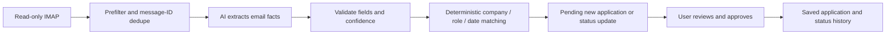

# Email sync: matching, models and reliability

Investigation and synthetic QA: October 27, 2026. Changes remain uncommitted.

## How an email connects to an application

AI extracts facts; application code chooses the target. The model receives the sender, subject and first 2,000 body characters. It returns a category, company, role, confidence and short summary. It never receives application IDs and cannot approve anything.



| Situation | Result |
|---|---|
| Company differs after normalization | New suggestion; no substring company match |
| Exact company and role | Prefer the open, most recent eligible application |
| Shortened role identifies one distinct title | Allow a whole-word phrase match |
| Explicit different role, or shortened title matches several roles | New suggestion for review; never fall back to an unrelated role |
| Email omits role | Reuse only the company's sole open eligible application |
| Confirmation after a rejection/withdrawal, or more than 120 days after applying | New hiring-cycle suggestion |
| Email predates a newer application | Exclude the newer application from matching |
| More emails for a pending suggestion | Merge permitted status progress into that suggestion |
| Application already Offered, Rejected or Withdrew | Reject regressions; an offer cannot become a rejection through email |

The date header and extracted company/title are imperfect evidence. Matching does not yet use ATS requisition IDs, posting URLs, thread IDs or a verified sender-company mapping. Two same-title openings at one company can remain ambiguous. This is why review remains required.

## Fixes implemented

- Removed mismatched-role fallback, ambiguous partial-role selection and the missing-role bypass of the 120-day rule. Historical messages cannot target a newer reapplication.
- Approval preserves closed and old hiring cycles. It checks the target still exists and protects newer statuses with conditional writes.
- Failed classification and suggestion writes stay retryable. Legacy processed rows marked `error` no longer suppress retries. A failed processed-log write can recover even after its suggestion was dismissed or approved.
- A scan cannot merge into a suggestion resolved during classification. A conflicting merge leaves that email unprocessed for retry.
- Classification uses a strict JSON schema plus runtime validation, with bounded timeouts and a bounded transient-provider retry. Provider errors omit raw response bodies.
- IMAP has a 25-second cap. Scan scheduling and persistence check a 50-second work budget, reserving time before the route's 60-second limit. Individual slow database requests can still exceed the remaining budget; a durable worker is the stronger long-term solution.
- Deferred work and the 300-message transport cap are visible. Auto-sync advances its success timestamp only after a complete successful scan. A capped mailbox requires a narrower manual date range; repeatedly scanning the same capped window will not recover the omitted oldest mail.
- Migration **011** adds expiring cross-instance scan leases, oldest-attempt scheduling and transactional/idempotent approval. Its functions enforce tenant ownership and lock approval rows and current applications.
- Fixed invalid paragraph nesting in the suggestion review queue after Playwright exposed hydration errors.

## Database rollout status

Migrations **009, 010 and 011 are now applied** to the configured Resume Butler project (`tlmabncoijnuxymxohgu`) through its authenticated SQL Editor. Each ran in a transaction and reported success. A metadata query confirmed auth limits, job-detail columns, scan-lock functions and atomic approval are present. These were manual SQL Editor migrations, consistent with this project's setup; the dashboard's CLI migration-history display is not the source of truth for this rollout.

The earlier 011 rollout retained compatibility approval writes. RB-01 removes that fallback: missing identity-safe approval functions now return a retryable setup error and leave suggestions pending. Scan-lock compatibility still has fewer cross-instance guarantees. The earlier source work was committed and deployed as `617ee97`; later RB-01 deployment is recorded separately.

### Application identity rollout (012)

Migration **012** is now installed in the connected project. Multiple same-title rows require an explicit choice rather than selecting the newest row. Approval rechecks current role/date/cycle eligibility; ambiguity discovered at approval persists candidate metadata so the UI can recover. Extension receipts, account/origin-bound queues and source-specific matching review use the same per-user lock. No classifier or model changes were made. See [RB-01 verification](application-identity-verification.md) for local/live tests and remaining limits.

`scripts/verify-email-integrity-qa.mjs` passed against real PostgreSQL through authenticated Supabase API clients. It checked lease contention, token ownership, tenant isolation, simultaneous approval of one suggestion, retained hiring cycles and rollback of a stale rejection against a newer offer. It retained the old Atlas application and created exactly one new cycle. Anonymous callers, direct lock-table access and authenticated access to the service-only auth-limit function are also checked. Mutations target only the recorded synthetic account; temporary manual status edits are restored.

## Current AI models and recommendation

The configured global model is now **gpt-6-luna**, switched globally at the user's explicit request after the initial evaluation. It currently serves email classification, resume entry selection/generation, bullet suggestions and rewrites, paragraph rewrites, cover-letter drafting and CV import. ATS scoring is deterministic and uses no model.

Task overrides now allow gradual evaluation:

| Variable | Features |
|---|---|
| `OPENAI_MODEL` | Global fallback; defaults to `gpt-6-luna` |
| `OPENAI_EMAIL_MODEL` | Email extraction/classification |
| `OPENAI_WRITING_MODEL` | Bullets, paragraphs and cover letters |
| `OPENAI_SELECTION_MODEL` | Resume tailoring and generation's entry selection |
| `OPENAI_IMPORT_MODEL` | Resume import |

The initial investigation left defaults unchanged. The user subsequently requested GPT-6 Luna, so the source fallback and local `OPENAI_MODEL` are now `gpt-6-luna` for all AI tasks. Hosted environment values have not been changed and an explicit hosted `OPENAI_MODEL` still overrides the source fallback. Modern model requests use completion-token limits and appropriate reasoning parameters. Email uses strict structured output; other tasks retain JSON-object output and their existing validators.

| Synthetic email evaluation | gpt-4o-mini | gpt-6-luna |
|---|---:|---:|
| Correct cases | 10/10 | 10/10 |
| Real model calls (one job alert prefiltered) | 9 | 9 |
| Mean latency | 1,147 ms | 1,238 ms |
| Input/output tokens | 4,671 / 335 | 4,644 / 423 |
| Estimated token cost | $0.000902 | $0.000676 |

Correct means category plus normalized company/title for job emails, and rejection of the job alert before AI. Fixtures include two roles, a reapplication and an instruction-injection attempt. This tiny corpus is a compatibility check, not proof of production accuracy, security or writing quality. Latency differences are not statistically meaningful.

The user chose a global GPT-6 Luna switch after this evaluation. It matched this email corpus at about 25% lower token cost. Larger labeled email tests and separate writing/selection/import evaluations remain useful for measuring factual preservation, CV selection and import accuracy. A flagship model such as GPT-6.1 Sol may help difficult writing, but no writing-quality evaluation justifies its extra cost yet.

Official references: [GPT-4o mini](https://developers.openai.com/api/docs/models/gpt-4o-mini) is marked deprecated; [GPT-6 Luna](https://developers.openai.com/api/docs/models/gpt-6-luna) lists $0.10/$0.50 input/output per million tokens; [GPT-6.1 Sol](https://developers.openai.com/api/docs/models/gpt-6.1-sol) lists $2/$10. The evaluation uses the published uncached token rates. See [structured outputs](https://developers.openai.com/api/docs/guides/structured-outputs).

## Evidence and rerunning

Use Node **24.x**, matching `package.json`.

```sh
npm test
npm run lint
npm run build
node --import ./tests/register.mjs scripts/evaluate-email-models.mjs /tmp/email-model-evaluation.json
```

Run builds in a separate snapshot when a preview is already serving `.next`; replacing its assets caused the earlier port-3015 CSS failure.

QA scripts use `.env.local` privately and write credentials only to a mode-0600 file inside a mode-0700 temporary directory. Never commit or paste that file's passwords or session tokens. Provision creates confirmed synthetic accounts without sending email:

```sh
node --import ./tests/register.mjs scripts/qa-email-sync.mjs provision
# Use the sessionPath printed by provision; replay once per freshly provisioned run.
node --import ./tests/register.mjs --experimental-test-module-mocks scripts/replay-email-qa.mjs <sessionPath>
# Playwright must be installed/resolvable; QA_PLAYWRIGHT_MODULE can select an existing module.
node scripts/browser-email-qa.mjs <sessionPath>
# Real cron orchestration, QA-only database scope, injected failure then recovery.
node --import ./tests/register.mjs --experimental-test-module-mocks scripts/auto-sync-email-qa.mjs <sessionPath>
# After SQL migration 011; adds one Atlas cycle in this dedicated QA account.
node scripts/verify-email-integrity-qa.mjs <sessionPath>
```

Observed against real Supabase and OpenAI, with only IMAP transport faked:

- Two dedicated accounts: `sync-qa-0bd32703df-primary@example.test` and `sync-qa-0bd32703df-other@example.test`. No existing users' mail or application rows were used.
- Ten synthetic messages produced seven pending suggestions; repeat replay classified zero messages and created zero suggestions. Saved applications stayed unchanged before approval.
- The second account could neither read the first account's applications/suggestions nor update its application through PostgREST RLS.
- Playwright used the real login and Add/Update controls to approve a Backend Engineer interview and a new Northstar hiring cycle. The tracker retained the old rejected Northstar application. Database status history records the backend transition.
- A QA-scoped admin wrapper exercised real auto-sync orchestration against only the primary test account: an injected provider outage counted as failure and preserved its watermark; a real-model retry succeeded and cleared the error. The live scheduler was not invoked.
- Synthetic email connection remains **auto_sync=false**. No live mailbox was accessed and no email was sent.
- Final automated suite: **61 passing tests**, clean ESLint and an isolated production build. After the SQL rollout, Playwright approved the Orbit offer through the real transactional RPC and confirmed the tracker/timeline with **zero page errors**. Real RPC integration and QA-scoped auto-sync failure/recovery also passed with migration 011 installed.

Local evidence is under `/tmp/resume-butler-email-*`, `/tmp/resume-butler-browser-qa*`, `/tmp/resume-butler-tests.log`, `/tmp/resume-butler-lint.log` and `/tmp/resume-butler-build.log`. These are temporary files, not committed artifacts.

## Remaining hardening priorities

1. Deploy the reviewed application changes so hosted code uses the installed RPCs. Keep the missing-migration compatibility warnings monitored in other environments.
2. Replace bounded request-time scans with a durable queue and per-mailbox UID/cursor checkpoints. This is needed for automatic recovery of large backlogs and reliable scheduling at more than a few inboxes per daily invocation.
3. Add real provider integration checks for IMAP authentication, MIME variants, disconnects and reconnects. Current transport tests and synthetic replay do not establish live-provider compatibility.
4. Add ATS requisition/thread evidence and show match reasons in review. Retain human review when evidence is ambiguous.
5. Add error monitoring and operational alerts for repeated partial scans, missing migrations and expired credentials. Daily cron currently looks back at most seven days; longer outages require manual recovery. Parse failures, missing Message-IDs and Gmail's excluded categories also limit completeness.
6. Expand the labeled model corpus, including multilingual emails and uncommon role/company names. Confidence is model-reported, not a calibrated correctness probability.

Gmail OAuth would improve connection setup and token revocation, but does not itself solve matching, replay, backlog or transaction integrity.
